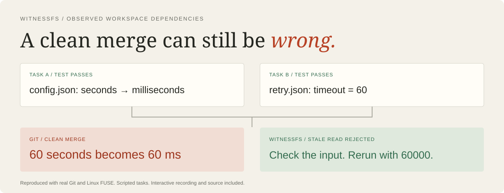

# WitnessFS

**Catch stale assumptions before combining parallel coding work.**

[](https://github.com/balkashynov/witnessfs/actions/workflows/check.yml)
[](LICENSE)

**[Live demo](https://balkashynov.github.io/witnessfs/)** ·
[The failure in 30 seconds](https://balkashynov.github.io/witnessfs/#replay-3) ·
[Engineering brief](docs/ENGINEERING-BRIEF.md) ·
[Measurements and limits](docs/VALIDATION.md)

[](https://balkashynov.github.io/witnessfs/)

WitnessFS is an experimental Rust filesystem for parallel coding workspaces.
Ordinary programs run in isolated Linux FUSE mounts. It records the file bytes,
metadata, missing paths and directory membership they observe. Before accepting
a workspace's writes, it validates those dependencies against the latest revision
and publishes all changes in one database transaction.

Two tasks can edit different files and still disagree about the world. The
included example makes that failure visible:

| Task A | Task B | Combined result |
| --- | --- | --- |
| Migrate a configuration from seconds to milliseconds | Read the old unit, then add a 60-second retry in another file | Git merges cleanly; the retry becomes **60 milliseconds** |
| Test passes in isolation | Test passes in isolation | The combined test fails |

WitnessFS accepts A and rejects B with a receipt naming `/config.json`. A fresh
branch reads the new unit, writes `60000`, and passes the combined tests.
This is a deterministic scripted example executed against real Git and FUSE,
not a recorded LLM session or an upstream production defect.

## Where it fits

Use it to experiment with parallel agent workspaces whose changes depend on
files they do not edit. Accepted source exports into your existing Git review
and CI workflow. Git remains the version-control system; WitnessFS adds an
observed-dependency check before integration.

The tradeoff is conservative rejection and extra I/O. A harmless comment change
can invalidate a whole-file read, and a broad search can make a large part of the
repository a dependency. Real coding-agent workloads have not yet been evaluated.

[Design and prior art](docs/DESIGN.md) ·
[Exact correctness contract](docs/CORRECTNESS.md) ·
[Recorded commands and receipts](docs/evidence/demo.json)

## Run the demonstration

Requires Docker with Linux FUSE support. On macOS, Docker Desktop supplies the
Linux kernel. Run from this repository:

```sh
git clone https://github.com/balkashynov/witnessfs.git
cd witnessfs
docker build -t witnessfs-dev:local .
mkdir -p .runs
docker run --rm --network none --device /dev/fuse --cap-add SYS_ADMIN \
  --mount "type=bind,src=$PWD,dst=/repo,readonly" \
  --mount "type=bind,src=$PWD/.runs,dst=/results" \
  witnessfs-dev:local python3 /repo/scripts/record_demo.py \
  --output /results/demo.json
```

This runs the same tasks through Git and through mounted WitnessFS branches,
asserts the results, records actual command output, and checks four additional
histories. It uses temporary fixtures and does not change your working files.
The container needs `/dev/fuse` and the mount capability; it has no network access.
Some Linux hosts also restrict FUSE through their AppArmor policy. Use an
appropriately configured test VM rather than broadly disabling host protections.

To view the committed recording:

```sh
python3 -m http.server 8765 --bind 127.0.0.1
# Open http://127.0.0.1:8765/demo/
```

The page is an interactive replay of the JSON records in `demo/data`, not live
execution. It needs no external service or JavaScript dependency.

## Use a workspace

On Linux, install Rust 1.93 or newer, a C compiler and `fuse3`, then
`cargo install --path . --locked`. The storage core and CLI also build on macOS;
mounting requires Linux.

```sh
# Use a stable source tree. Keep the store outside it.
witnessfs --store /tmp/my-witness init --from /path/to/source-snapshot
witnessfs --store /tmp/my-witness branch task-a
mkdir /tmp/task-a
witnessfs --store /tmp/my-witness mount task-a /tmp/task-a
```

The mount runs in the foreground. In another terminal, run your editor, shell,
compiler or coding agent with `/tmp/task-a` as its working directory. Keep every
relevant workspace read for that task in this branch.

```sh
cd /tmp/task-a
# Make and test the change using ordinary tools.
cd /tmp
fusermount3 -u /tmp/task-a
witnessfs --store /tmp/my-witness observe task-a
witnessfs --store /tmp/my-witness seal task-a
witnessfs --store /tmp/my-witness accept task-a
witnessfs --store /tmp/my-witness export /tmp/accepted-source
```

`accept` exits **0** on acceptance, **3** on a dependency conflict, **1** on an
operational error. It is idempotent after a decision. `receipt task-a` retrieves
the decision. `export /tmp/rejected-work --branch task-a` preserves a rejected
branch for inspection. A retry is a **new branch from the current revision**;
reconsider its plan against fresh inputs rather than blindly replaying a stale
patch. Sealed or decided branches cannot be reopened for mutation.

For an initial experiment, import source without `.git`, dependency caches or
build outputs. Importing `.git` also versions its mutable index and refs, often
creating unrelated conflicts. Export accepted source into a normal review
workflow. WitnessFS does not automatically commit, push or integrate with a forge.
Review, combined tests and CI remain necessary.

## Underneath

```text
                       ordinary tools / coding agents
                                  │
                       Linux VFS → per-branch FUSE
                                  │
                    observed reads + private overlay
                                  │
                    unmount → seal → validate at head
                                  │
                   one SQLite FULL/WAL transaction
                           ╱              ╲
                    mismatch              match
                  keep private     publish writes + receipt
```

Snapshots store a revision number without copying file content. The namespace
and inodes have separate versioned keys, so rename, hard links and an unlinked
open file retain their identities. Content uses SHA-256 addressed 64 KiB chunks
with zero padding omitted. A process lease excludes a mounted branch from
out-of-band mutation or acceptance.

Readable opens record the entire file dependency, covering cached and mmap
reads that may bypass a FUSE read callback. The exclusive mount retains the
kernel's data cache across opens. Entry and attribute TTLs are zero.
Failed operations retain their observations while rolling back their effects.
The ordinary release binary contains no active crash-injection hooks.

## What has been checked

- Eight core transaction tests and an independent serial interpreter over 640
  generated transactions, including write skew, absent paths and enumeration.
- Eighteen actual Linux FUSE tests: 1,200 generated file operations compared
  with native Linux behavior, compiled executable files, cached/mmap reads,
  flushed shared mmap writes, sparse files, hard links, rename and mount leases.
- Four forced process kills around acceptance. Recovery exposes either both
  old files or both new files, with the matching receipt state.
- A real Git merge, stale rejection, fresh retry and exported combined tests.
- A recorded false rejection caused by a harmless comment change.

These bounded tests are not a formal proof or a production qualification.
Exact commands, results, source hashes and performance limits are in
[VALIDATION.md](docs/VALIDATION.md). Run all local container checks with
`bash scripts/verify.sh`; measure costs with `bash scripts/verify.sh --benchmark`.

## Limits that matter

This is an **experimental component**, not a security sandbox or a semantic
correctness checker. It sees supported operations inside its mount. It does not
track previous conversations, host files, external symlink destinations, network
services, clocks, process state or external databases. A pinned toolchain and a
separate OS sandbox are sensible integration requirements.

Whole-file dependencies are conservative. A harmless comment can reject useful
work; a broad search can make the entire repository a dependency. The current
single SQLite writer and synchronous durability impose overhead. Snapshots are
cheap; file I/O is measurably slower than the native filesystem.

There is no garbage collector, distributed coordinator, branch deletion,
automatic rebase or fine-grained symbol tracking. Files are capped at 1 GiB,
individual I/O requests at 16 MiB. Special files, extended attributes, pre-epoch
timestamps and several advanced filesystem operations are unsupported. Directory
metadata does not automatically change with child membership; directory link
counts are virtual. Capacity reporting is not a supported input to the validation
contract. See [the exact contract](docs/CORRECTNESS.md).

## Related work

Optimistic concurrency, transactional filesystems and dynamic dependency tracking
are established ideas. [Zit](https://getzit.org/science) already applies agent
transactions with declared and inferred symbol dependencies.
[BranchFS](https://github.com/multikernel/branchfs),
[AgentFS](https://github.com/tursodatabase/agentfs) and
[Factory VFS](https://github.com/Factory-AI/vfs) explore important neighboring
workspace designs. WitnessFS's experiment is transparent observation of the
filesystem boundary with conservative, deterministic acceptance and reproducible
failure evidence. It does not claim to be the first transactional agent workspace.

The problem is relevant to agent development infrastructure. Anthropic's
[Scion article](https://www.anthropic.com/engineering/redesigning-source-control)
describes rapidly growing change volume and concurrent integration pressure.
This is an independent project, with no Anthropic affiliation or endorsement.

MIT licensed. Built by Ivan Balkashynov.
